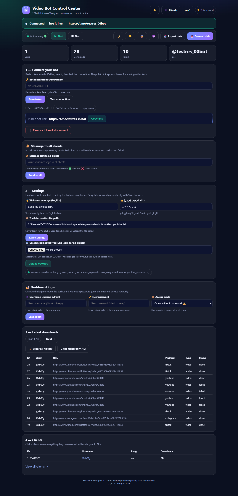
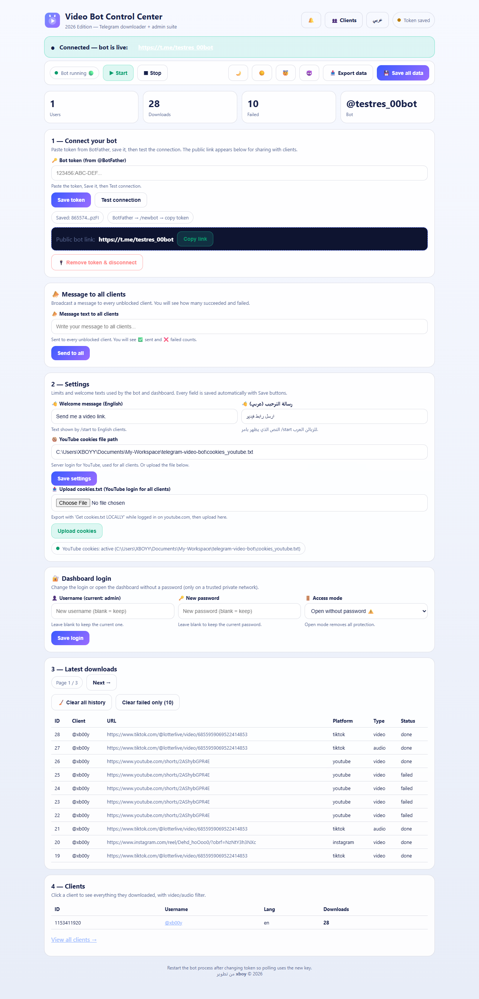

# Telegram Video Downloader Bot + Dashboard

> Phone screenshot of the Telegram bot chat: `docs/screenshots/telegram-bot.png`

---

## English

Download videos and audio from **YouTube, TikTok, Facebook, Instagram** and 1000+ other supported sites, straight through Telegram — with a full web admin dashboard.

### Features

- 🎬 Telegram bot (aiogram 3): video / audio download with live progress bar, cancel button and persistent quick buttons
- 🌍 6 interface languages with per-user choice: English, Arabic, Russian, French, Spanish, Chinese
- 🏷️ Real platform titles as video captions (reads downloader metadata — works on every supported site)
- ❌ Friendly error messages for clients, detailed errors for the admin
- 🔑 Per-user YouTube login via cookies file, plus server-wide cookies for all clients
- 🖥️ Dashboard: bot token setup + connection test + public link copy, start/stop the bot, broadcast to all clients, clients list with full history and filters, error bell with details, paginated history, Excel export, 4 themes, changeable login password
- 💾 SQLite storage, Docker + Render ready

### Run locally

1. `pip install -r requirements.txt`
2. Copy `.env.example` to `.env` and set `BOT_TOKEN` and `ADMIN_IDS`
3. `python -m app.bot` — Telegram polling
4. `uvicorn app.dashboard:app --port 8000` — dashboard at http://127.0.0.1:8000

### Deploy on VPS

- Install `ffmpeg`, `python3`, `yt-dlp`
- Use the `Dockerfile`, or run bot + dashboard with systemd
- Upload YouTube `cookies.txt` from the dashboard for reliable YouTube downloads

### Notes

- Never commit `.env`, `bot.db`, `downloads/` or `cookies*.txt` (already in `.gitignore`)
- One bot token = one running bot. Do not share the token with other tools, or chats and command menus will conflict

---

## العربية

حمّل الفيديو والصوت من **يوتيوب وتيك توك وفيسبوك وانستغرام** وأكثر من 1000 موقع مدعوم، مباشرة عبر تلغرام — مع لوحة تحكم ويب كاملة.

### المميزات

- 🎬 بوت تلغرام (aiogram 3): تحميل فيديو / صوت مع شريط تقدم حي وزر الغاء وازرار سريعة دائمة
- 🌍 6 لغات يختار منها كل زبون: انجليزي وعربي وروسي وفرنسي واسباني وصيني
- 🏷️ عنوان الفيديو المرسل مطابق لعنوان المنصة (يقرا بيانات التحميل — يعمل على كل المواقع المدعومة)
- ❌ رسائل خطا بسيطة للزبائن وتفصيلية للادارة
- 🔑 تسجيل دخول يوتيوب لكل زبون عبر ملف كوكيز، اضافة لكوكيز عام للجميع
- 🖥️ اللوحة: اعداد التوكن واختبار الاتصال ونسخ الرابط، تشغيل/ايقاف البوت، رسالة جماعية لكل الزبائن، قائمة العملاء مع السجل والفلترة، جرس اخطاء بالتفاصيل، ترقيم الصفحات، تصدير Excel، 4 ثيمات، تغيير كلمة المرور
- 💾 تخزين SQLite وجاهزية Docker و Render

### التشغيل محليا

1. `pip install -r requirements.txt`
2. انسخ `.env.example` الى `.env` وضع `BOT_TOKEN` و `ADMIN_IDS`
3. `python -m app.bot` — تشغيل البوت
4. `uvicorn app.dashboard:app --port 8000` — اللوحة على http://127.0.0.1:8000

### النشر على VPS

- ثبت `ffmpeg` و `python3` و `yt-dlp`
- استعمل `Dockerfile` او شغل البوت واللوحة عبر systemd
- ارفع `cookies.txt` الخاص بيوتيوب من اللوحة لتحميل موثوق

### ملاحظات

- لا ترفع ابدا `.env` او `bot.db` او `downloads` او `cookies*.txt` (مخفية في `.gitignore`)
- توكن واحد = بوت واحد يعمل. لا تشارك التوكن مع ادوات اخرى والا تضاربت المحادثات وقوائم الاوامر

---

## 中文

通过 Telegram 从 **YouTube、TikTok、Facebook、Instagram** 及 1000+ 个支持网站下载视频和音频，并配有完整网页管理后台。

### 功能

- 🎬 Telegram 机器人（aiogram 3）：视频 / 音频下载，实时进度条、取消按钮、常驻快捷按钮
- 🌍 6 种界面语言，每位用户可自选：英语、阿拉伯语、俄语、法语、西班牙语、中文
- 🏷️ 发送的视频标题与平台标题一致（读取下载元数据——所有支持网站通用）
- ❌ 给用户简单易懂的错误提示，给管理员详细错误信息
- 🔑 每位用户可用自己的 cookies 文件登录 YouTube，另有全站通用 cookies
- 🖥️ 后台：机器人 Token 配置 + 连接测试 + 公开链接复制，启动/停止机器人，群发消息，客户列表及完整记录与筛选，错误铃铛及详情，分页，Excel 导出，4 套主题，可改登录密码
- 💾 SQLite 存储，支持 Docker 与 Render 部署

### 本地运行

1. `pip install -r requirements.txt`
2. 复制 `.env.example` 为 `.env`，填写 `BOT_TOKEN` 和 `ADMIN_IDS`
3. `python -m app.bot` — 启动机器人
4. `uvicorn app.dashboard:app --port 8000` — 后台地址 http://127.0.0.1:8000

### VPS 部署

- 安装 `ffmpeg`、`python3`、`yt-dlp`
- 使用 `Dockerfile`，或用 systemd 运行机器人与后台
- 在后台上传 YouTube `cookies.txt` 以保证下载稳定

### 注意

- 切勿提交 `.env`、`bot.db`、`downloads/`、`cookies*.txt`（已在 `.gitignore` 中忽略）
- 一个 Token 只能运行一个机器人实例，切勿与其他工具共用，否则聊天与命令菜单会冲突

---

Developed by **xboy** © 2026 — من تطوير **xboy** — 由 **xboy** 开发
